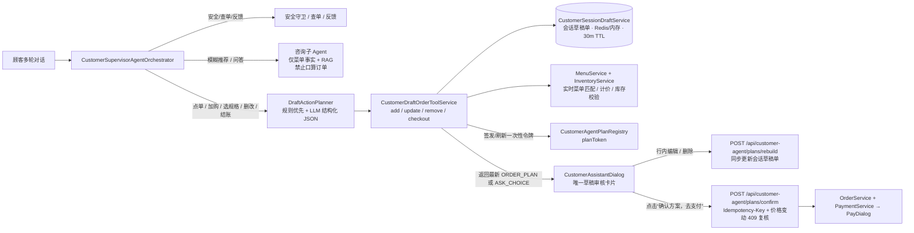

# FIKA 顾客 Agent 会话草稿单与受控下单闭环 PRD

> 版本：v1.0  
> 更新日期：2026-11-25  
> 范围：FIKA 顾客助手（Supervisor Agent）的多轮点单生成、多轮商品合并、草稿单审核、编辑/删除以及确认跳转支付全链路重构。  
> 实施原则：以**服务端会话草稿单（Session Draft Order）**作为唯一真相源（Single Source of Truth），将“推荐咨询”与“确定性点单/合并/结账工具”彻底解耦；LLM 仅负责意图理解与自然语言表达，商品匹配、数量解析、合并、库存校验、实时计价与建单全部由服务端确定性代码执行。

---

## 1. 背景与痛点复盘

当前顾客助手在“单轮咨询推荐”场景表现稳定，但在进入多轮点单、追加合并、提交审核与确认支付环节存在四类典型线上问题：

1. **单品点单数量错乱**：例如用户输入“来杯茉莉花茶”，由于 `CustomerOrderLlmIntentParser` 将词典抽取词与 LLM 返回词合并后按 `mustInclude.size()` 推算件数，导致未写显式数字的单品请求被误判为 `itemCount = 2`，错误生成 2 份（¥32.00）。
2. **多轮追加与结账路由失效，触发咨询子 Agent 幻觉算账**：
   - `CustomerSupervisorAgentOrchestrator.route()` 依赖静态关键词与正则分流，且 `isCheckoutIntent()` 与 `isMergeFollowUp()` 规则冲突（例如“饮品跟汉堡一起结账”被排除出结账，又因 `hasConcreteAddTarget()` 未匹配到完整商品名而被退回 `CONSULT`）。
   - 一旦落入无工具的咨询子 Agent，LLM 只能用纯文本回复“已为您记录：2 份小份汉堡和 1 杯茉莉花茶，总计 20 元”，既未修改任何订单状态，又发生严重算账幻觉，导致无法弹出确认卡片与支付按钮。
3. **前后端状态割裂与 `planToken` 过期断链**：
   - 待确认方案 `activePlan` 仅保存在前端组件内存中，后端会话只保存纯文本历史；`CustomerAgentPlanRegistry` 的 `planToken` 只有 5 分钟 TTL，多轮对话或合并失败后容易出现 410 过期或状态丢失。
   - 前端 `CustomerAssistantDialog.vue` 堆叠了大量兼容旧后端的本地正则兜底逻辑，与后端状态互相干扰。
4. **审核卡片与支付跳转体验断点**：
   - 审核卡片规格编辑硬编码为“小杯/中杯/大杯”，未按品类区分轻食/甜点的“小份/中份/大份”。
   - 审核卡片仅用 `estimatedPrice * quantity` 粗算总价，未展示服务端试算的满减/优惠提示，且不支持在审核环节删除单项或同步履约方式。

---

## 2. 目标与核心设计原则

1. **唯一真相源（Server-Side Draft Order）**：每个顾客会话 `(sessionId, ownerKey, storeId)` 在服务端维护一份结构化草稿订单。所有新增、合并、修改规格、删除商品与结账预览都直接操作服务端草稿单。
2. **推荐与交易工具彻底解耦**：
   - 模糊口味推荐、问答与售后咨询仍走咨询子 Agent（菜单事实 + RAG）；**严禁咨询子 Agent 在无工具执行的情况下宣称“已记录订单”或自行计算总价**。
   - 明确点单、追加商品、按价格/规格回复、修改/删除商品、合并结账统一进入受控草稿单工具链（`CustomerDraftOrderToolService`）。
3. **确定性计价与库存校验**：草稿单的每一行商品必须来自当前门店实时上架菜单（`available=true`），数量、规格、加料、库存与金额全部由服务端实时计算。
4. **零人工跳过、平滑跳转支付**：模型与工具永远只产出草稿单与一次性 `planToken`，**不自动创建订单或扣款**；用户在聊天内审核卡片核对明细、修改规格或删除单项后，点击“确认方案，去支付”调用 `/api/customer-agent/plans/confirm` 幂等建单，并无缝拉起 `PayDialog` 完成支付。

---

## 3. 端到端架构与状态机

### 3.1 端到端交互流



### 3.2 会话草稿单状态机

| 状态 | 含义 | 允许流转 |
|---|---|---|
| `EMPTY` | 当前会话尚无已选商品 | `add_item` → `DRAFTING` |
| `DRAFTING` | 已包含 1–10 行商品，处于持续挑选/合并中 | `add_item` / `update_item` / `remove_item` → `DRAFTING`（若删空则 → `EMPTY`）；`preview_checkout` → `REVIEW_READY` |
| `REVIEW_READY` | 用户表达挑选结束或要求结账，已刷新最新 `planToken` 等待点击确认 | 继续加购/编辑 → `DRAFTING`；用户点击确认建单 → `SUBMITTED` |
| `SUBMITTED` | 已成功通过 `/plans/confirm` 创建正式待支付订单 | 自动清空草稿行（防重复下单），后续新点单开启新一轮 `DRAFTING` |

---

## 4. 核心数据模型与服务设计

### 4.1 服务端会话草稿单（`CustomerSessionDraftService`）

按 `(sessionId, ownerKey, storeId)` 隔离存储，支持 Redis（生产/启用 `redis` profile）与 JVM 内存（本地无 Redis 时自动回退），TTL 为 **30 分钟**且每次读写自动续期。

```json
{
  "sessionId": "32位会话ID",
  "ownerKey": "USER:1|STORE:1",
  "storeId": 1,
  "version": 3,
  "status": "DRAFTING",
  "fulfillmentType": "PICKUP",
  "pendingProductCode": null,
  "pendingQuantity": null,
  "latestPlanToken": "a1b2c3...",
  "items": [
    {
      "lineId": "line-1",
      "productCode": "jasmine_tea",
      "productId": 12,
      "productName": "茉莉花茶",
      "categoryCode": "tea",
      "temperature": "COLD",
      "size": "MEDIUM",
      "quantity": 1,
      "condiments": [],
      "unitPrice": 16.00,
      "lineSubtotal": 16.00,
      "imageUrl": "/uploads/..."
    }
  ],
  "pricing": {
    "itemsSubtotal": 36.00,
    "estimatedCouponDiscount": 0.00,
    "estimatedPayable": 36.00,
    "promotionText": "还差 ¥12.00 可享满 ¥48 减 ¥8"
  },
  "updatedAt": "2026-11-25T22:45:00Z"
}
```

### 4.2 确定性草稿单工具集（`CustomerDraftOrderToolService`）

1. **`addItem(session, storeId, userId, guestId, productQuery, size, quantity, temperature, condiments)`**
   - **菜单解析**：在当前门店 `available=true` 且有库存的商品中，按“精确名称 → 归一化包含 → 品类关键词”三阶匹配。
   - **歧义处理**：
     - 命中 0 款：返回友好提示 + 当前门店相近品类真实菜单选择卡（`ASK_CHOICE`），不伪造商品。
     - 命中多款（如“汉堡”匹配到多款汉堡）：将 `pendingQuantity` / `pendingSize` 暂存到草稿上下文，返回 `ASK_CHOICE`（`choiceKind: PRODUCT`）供用户点选。
     - 命中唯一商品且需确认规格（仅在用户主动问规格/价格时）：暂存 `pendingProductCode`，返回规格选择卡（`小杯/中杯/大杯` 或 `小份/中份/大份` + 实时三档价格）。
     - 命中唯一商品且意图明确（如“来杯茉莉花茶”、“2个10元的”）：按规格默认规则（未指定则 `MEDIUM`，或按用户报出的价格反推对应 `SMALL`/`MEDIUM`/`LARGE`）直接写入草稿单。
   - **合并规则**：相同 `(productCode, size, condiments)` 自动累加数量（上限 9 份），不同商品/规格追加新行（单笔上限 10 种商品）；每次变更校验 `inventoryService.hasAvailable(storeId, productId, totalQuantity)` 并重新计价。
   - **即时签发 `planToken`**：每次草稿单有商品行时，调用 `CustomerOrderAgentService.rebuild(..., replace=true)` 生成最新 `planToken` 并写回草稿单，保证审核卡片随时可点击去支付。

2. **`updateItem(session, storeId, userId, guestId, lines)`**
   - 供前端审核卡片行内编辑规格/数量/加料时调用；同步更新服务端草稿单并签发新 `planToken`。

3. **`removeItem(session, storeId, userId, guestId, lineIndex)`**
   - 支持用户通过对话（如“不要汉堡了”）或审核卡片删除按钮移除某一行；若移除后草稿单为空，清空 `latestPlanToken` 并返回空草稿状态。

4. **`previewCheckout(session, storeId, userId, guestId)`**
   - 响应“一起结账”、“去支付”、“暂时不用了”、“就这样”、“买单”等结账/结束挑选意图。
   - 服务端重新核验草稿单全部商品的实时价格与库存，刷新 `planToken`，返回 `action.type = "ORDER_PLAN"` 审核卡片，并用确定性模板输出精确商品清单与合计金额（**绝不交由 LLM 估算数字**）。

### 4.3 意图解析与数量防翻倍修复

1. **修复 `CustomerOrderLlmIntentParser` 数量误判 Bug**：
   - 在 `CustomerOrderIntentCatalog.mergeExplicitProductTerms` 与 `CustomerOrderLlmIntentParser.mapToIntent` 中，对互相包含的商品词（如“茉莉花茶”与“花茶”）严格保留最长精确词，避免同一商品被算成 2 个词。
   - 当原始文本未出现显式大于 1 的数量词且仅指向 1 款商品（如“来杯茉莉花茶”）时，`itemCount` 严格为 **1**。
2. **路由优先级重构（`CustomerSupervisorAgentOrchestrator`）**：
   - `UNSAFE`（提示注入拦截）
   - `ORDER_QUERY`（明确查单/订单号/物流）
   - `FEEDBACK`（明确反馈/投诉/售后）
   - **草稿单工具路由**（`DRAFT_CHECKOUT` / `DRAFT_REMOVE` / `DRAFT_ADD_OR_UPDATE`）：
     - 明确结账/结束挑选（“一起结账”、“饮品跟汉堡一起结账”、“去支付”、“买单”、“暂时不用了”、“就这样”）→ 当草稿单非空时直接走 `previewCheckout`（不再被 `isCheckoutIntent` 排除或因 `hasConcreteAddTarget` 退回咨询！）。
     - 规格/价格短回复（“2个10元的”、“小份”、“18元，冰”）→ 结合草稿单 `pendingProductCode` 或最近助手回复，直接走 `addItem` 合并进草稿单。
     - 明确点单/追加/删除（“来杯茉莉花茶”、“我还需要一个汉堡”、“再加一份可颂”、“去掉汉堡”）→ 走草稿单工具 `addItem` / `removeItem`，合并进同一份会话草稿单。
     - 模糊组合推荐点单（带预算/多品类搭配，如“预算40，来份下午茶套餐”）→ 仍复用 `CustomerOrderAgentApplicationService.plan()` 确定性组合排序，并将选定方案同步写入会话草稿单，方便后续继续追加合并。
   - `CONSULT`（纯咨询与推荐）：System Prompt 明确禁止宣称“已为您记录订单”或口算总价；若当前会话已有草稿单，响应可附带当前草稿单提示，引导用户继续加购或结账。

---

## 5. 接口契约升级（向后兼容）

1. **`POST /api/customer-agent/assistant`**（现有接口扩展，完全向后兼容）
   - 请求参数不变：`{ storeId, sessionId, message, planToken }`（`planToken` 作为兼容回退，服务端优先读取 `sessionId` 对应的草稿单）。
   - 返回的 `action.type === "ORDER_PLAN"` 的 `payload` 新增：
     - `draftVersion`: number（草稿版本号，前端据此唯一高亮最新审核卡片，旧卡片自动置灰为“已更新/已合并”）
     - `sessionId`: string
     - `pricing`: `{ itemsSubtotal, estimatedCouponDiscount, estimatedPayable, promotionText }`
     - `fulfillmentType`: `"PICKUP" | "DINE_IN" | "DELIVERY"`
2. **`POST /api/customer-agent/plans/rebuild`**（现有接口增强）
   - 请求新增可选字段 `sessionId`：前端在审核卡片编辑规格/数量/加料或删除某一项时携带 `sessionId`，服务端同步更新该会话的草稿单并签发新 `planToken`；当 `lines` 为空且 `replace=true` 时允许清空草稿单。
3. **`POST /api/customer-agent/plans/confirm`**（现有正式建单接口）
   - 请求新增可选字段 `sessionId`：建单成功后自动将对应会话草稿单标记为 `SUBMITTED` 并清空已建单商品行，避免用户返回对话窗口误触重复建单。
   - 保持现有 `Idempotency-Key` 幂等保护、库存校验、409 菜单价变动二次确认弹窗以及 `paymentService.createForOrder()` 自动生成 `paymentNo` 的正式链路。

---

## 6. 前端交互与审核支付闭环（`CustomerAssistantDialog.vue` & `HomeView.vue`）

1. **移除前端脆弱兜底逻辑**：删除 `CustomerAssistantDialog.vue` 中用于补救旧后端的本地正则解析与二次合并代码（`localChoicePlanMessage`、`attachMergedPlan`、`attachRecommendationPlan` 等），彻底统一由服务端草稿单驱动 UI。
2. **统一草稿单审核卡片**：
   - 按商品 `categoryCode` 智能展示规格标签：饮品（`coffee`/`tea`/`ice`）显示 **小杯 / 中杯 / 大杯**，轻食/甜点（`food`/`dessert`）显示 **小份 / 中份 / 大份**。
   - 行内操作支持：**编辑规格/数量/加料**、**移除该商品**（均调用 `/plans/rebuild` 并传入 `sessionId`，实时刷新服务端计价与新 `planToken`）。
   - 底部汇总区展示服务端计算的 **预计合计** 与 **优惠提示**，并提供 **确认下单，去支付 →** 主按钮。
3. **确认下单与跳转支付**：
   - 点击“确认下单，去支付 →”后，`CustomerAssistantDialog` 发射 `checkout(planToken, false, runId, sessionId)`；
   - `HomeView.submitAgentOrder()` 调用 `customerAgentApi.confirm(...)` 完成幂等建单与支付单创建，成功后直接拉起 `PayDialog`（携带 `orderId` 和 `paymentNo`），关闭助手弹窗前保留清晰的成功提示；如遇 409 价格变动，弹窗展示逐行差价并支持一键接受新价继续支付。

---

## 7. 验收标准与必测回归场景

1. **单品数量准确**：用户输入“来杯茉莉花茶” → 草稿单中茉莉花茶数量严格为 **1 份**（¥16.00），不再误生成 2 份。
2. **多轮点单 + 价格反推规格 + 自动合并**（还原截图完整链路）：
   - Round 1：“有什么好喝的饮品” → `CONSULT`（推荐饮品，无订单幻觉）
   - Round 2：“来杯茉莉花茶” → 草稿单新增 1 份茉莉花茶（v1），展示审核卡片（合计 ¥16）
   - Round 3：“我还需要一个汉堡” → 命中汉堡后按规格提示或直接入单（若需选份量则记录 `pendingProductCode` 并展示份量价格选择卡）
   - Round 4：“2 个 10 元的” → 反推 2 份小份汉堡并**自动合并**进同一草稿单（v2：1 杯茉莉花茶 + 2 份小份汉堡，合计 ¥36.00），展示完整合并审核卡片
   - Round 5：“暂时不用了” / “饮品跟汉堡一起结账” → 直接走 `previewCheckout`，展示包含全部 3 件商品的最终审核卡片（合计 ¥36.00），绝不掉回咨询子 Agent 算成 20 元。
3. **审核卡片行内编辑与删除**：用户可修改某行规格/数量/加料或删除某行，服务端草稿单同步更新并签发新 `planToken`，旧卡片置灰禁用。
4. **确认下单与跳转支付**：点击“确认方案，去支付 →”后携带 `Idempotency-Key` 创建正式待支付订单（含全部合并明细）、自动清空草稿单并拉起 `PayDialog`。
5. **回归门禁**：后端 `mvn -B test` 全量通过（含新增草稿单与多轮合并单元测试），前端 `npm run build` 类型检查与构建通过。
